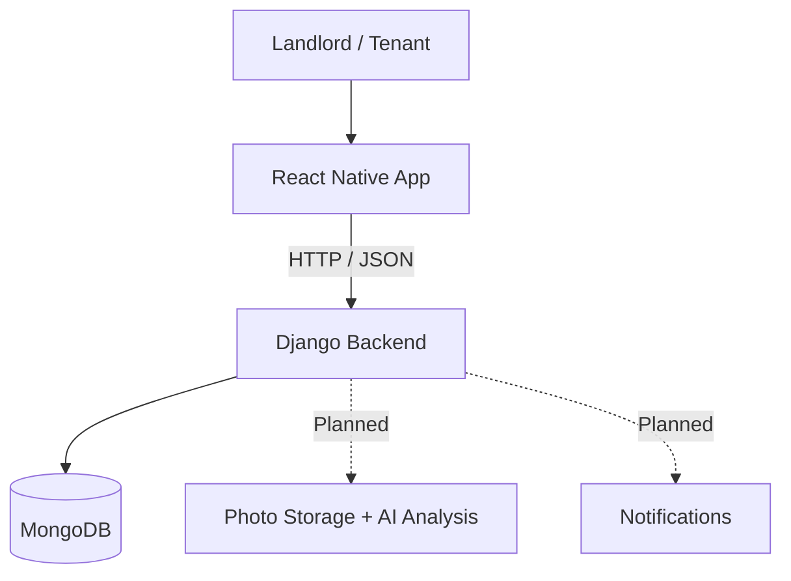

# LeaseGuard

**Software Engineering Capstone | Group 4 | Farmingdale State College**

[](https://github.com/jaskaranbhogal/LeaseGuard/actions/workflows/ci.yml)

LeaseGuard is a mobile application that helps landlords and tenants document rental-property conditions, complete inspections, and track maintenance issues. It aims to establish a consistent move-in baseline and use future AI-assisted photo comparisons to flag potential changes **for landlord review**, not make automatic damage decisions.

**Project links:** [Figma prototype](https://www.figma.com/design/28N5do1M7uUQwJWH3uKGSb/LeaseGuard-%E2%80%93-Sprint-Prototype) · [GitHub Kanban board](https://github.com/users/jaskaranbhogal/projects/1/views/1) · [User stories and acceptance criteria](USER_STORIES.md) · [GitHub Actions](https://github.com/jaskaranbhogal/LeaseGuard/actions)

## Features and Development Status

| Implemented / prototype | Planned or in progress |
| --- | --- |
| Registration, login, password reset, tenant/landlord roles | Property/unit management and tenant assignments |
| Role-specific dashboard and inspection UI **using sample data** | Persistent inspection, maintenance, and history records |
| Guided inspection, maintenance, history, notifications, and settings **prototypes** | Image storage, baseline comparisons, and AI-assisted damage findings |
| Django authentication backed by MongoDB, automated tests, and CI | Verify live MongoDB Atlas connection and production deployment |

**Scope:** Screens for properties, inspections, maintenance, and history are largely prototypes; completing a screen does not complete its full user story. Details and priorities are tracked on the [project board](https://github.com/users/jaskaranbhogal/projects/1/views/1). The initial backlog and acceptance criteria are in [USER_STORIES.md](USER_STORIES.md).

## Prototype (Sprint 1)

The [Figma prototype](https://www.figma.com/design/28N5do1M7uUQwJWH3uKGSb/LeaseGuard-%E2%80%93-Sprint-Prototype) includes **personas, a context diagram, UI designs, and UX workflows**, as required for the prototype assignment.

- **Landlord persona — Marcus Reed:** Manages multiple rental units and needs a way to schedule inspections, review condition changes, and track repairs remotely.
- **Tenant persona — Alyssa Patel:** Needs a clear way to document existing damage, submit inspection photos, and report maintenance concerns.
- **Context diagram:** Identifies tenants and landlords as users, plus planned AI analysis and notification services as external systems.
- **Interface designs:** Authentication, dashboards, property/unit management, inspections, photo review, maintenance, history, notifications, and settings.
- **Landlord workflow:** Sign in → select a property → schedule inspection → review submitted photos/findings → track maintenance and history.
- **Tenant workflow:** Sign in → start guided inspection → capture/review photos → report maintenance or availability → view history.

## Architecture (Sprint 1)

LeaseGuard uses a **client–server architecture**:

- **Frontend:** React Native and TypeScript for iOS/Android screens, navigation, forms, and HTTP/JSON requests.
- **Backend:** Python 3.12 and Django 5.2 for authentication, sessions, API logic, and data access.
- **Database:** MongoDB using the official Django MongoDB Backend. Automated CI tests use an isolated replica set; the team's hosted Atlas connection still needs verification.
- **Planned integration:** Secure photo storage and AI-assisted comparisons between baseline and later inspection images, with findings reviewed by landlords.



The React Native app never connects directly to MongoDB or stores database credentials. The dashed diagram connections represent planned functionality.

## Getting Started

**Requirements:** Python 3.12, Node.js 22+, npm, a MongoDB replica set or Atlas URI, and Xcode/CocoaPods (iOS) or Android Studio (Android). LeaseGuard uses React Native CLI, not Expo.

**1. Backend — from the repository root (macOS/Linux):**

```bash
git clone https://github.com/jaskaranbhogal/LeaseGuard.git
cd LeaseGuard
python3 -m venv venv
source venv/bin/activate
pip install -r requirements.txt
cp .env.example .env
```

Set `MONGODB_URI` and `MONGODB_DB_NAME` in the ignored `.env` file. Django reads **process environment variables**, so export them before running commands:

```bash
set -a
source .env
set +a
python manage.py migrate
python manage.py runserver 127.0.0.1:8000
```

**2. Frontend — in a new terminal:**

```bash
cd frontend
npm ci
npm start
```

In another terminal inside `frontend/`, use `npm run ios` or `npm run android`. For a new iOS environment, install CocoaPods from `frontend/` with `bundle install`, then `cd ios && bundle exec pod install` before launching. See [React Native setup](https://reactnative.dev/docs/set-up-your-environment) for platform requirements.

**Authentication:** Registration and login use Django sessions with CSRF protection. For local password-reset testing, run `python manage.py send_password_resets` in a separate configured backend terminal; console email mode does not send real messages. See [authentication details](docs/AUTHENTICATION.md) and [tenant/landlord integration](docs/TENANT_INTEGRATION.md).

**Security:** Never commit `.env`, secret keys, API credentials, or MongoDB connection strings.

## Test Plan (Sprint 1)

Testing covers individual components, connected workflows, manual mobile behavior, and automated CI.

| Test level | Example checks | Tools |
| --- | --- | --- |
| **Unit** | Registration validation, invalid credentials, UI behavior | Django tests; Jest |
| **Integration** | Register/login, persisted user role, sessions, logout, navigation | Django test client; frontend tests with mocked API |
| **System / manual** | Launch on simulator, choose tenant/landlord, navigate dashboards, test password reset and sign-out | Xcode iOS Simulator; Android emulator |
| **CI** | Django configuration/migrations/tests; TypeScript, lint, Jest; native builds in separate workflow | GitHub Actions |

**Run frontend checks** from `frontend/`:

```bash
npm test -- --ci --runInBand
npx tsc --noEmit
npm run lint
```

**Run backend checks** from the repository root with your virtual environment active:

```bash
python manage.py check
python manage.py makemigrations --check --dry-run
python manage.py test
```

Backend tests must use an **isolated local MongoDB replica set**, not a shared Atlas cluster: the Django test runner creates and removes a temporary test database. The CI workflow provisions its own disposable MongoDB instance automatically. See [CI configuration](.github/workflows/ci.yml).

## Sprint 2 — CI/CD, Reviews, and Branch Protection

The [main GitHub Actions workflow](.github/workflows/ci.yml) implements the required four stages:

| Stage | Purpose |
| --- | --- |
| **Setup** | Configure Python and Node.js |
| **Dependencies** | Install/cache backend and mobile dependencies |
| **Test** | Run Django and Jest tests after Django and React Native checks |
| **Deploy** | Package a versioned backend artifact; optionally deploy to Render after configuration |

**Deployment status:** The current Deploy job prepares an **artifact only**; it is **not proof of a live Render deployment**. Production Atlas connectivity remains unverified. The separate [mobile build workflow](.github/workflows/mobile-build.yml) checks iOS/Android builds.

**Team Git workflow:** Work is tracked as user stories/tasks on the [Kanban board](https://github.com/users/jaskaranbhogal/projects/1/views/1), implemented in feature branches, submitted as pull requests, and reviewed before merge. The active [`main` ruleset](https://github.com/jaskaranbhogal/LeaseGuard/rules/24912861) requires a teammate approval, up-to-date branches, and passing **Django Checks**, **React Native Checks**, and **Test** jobs.

**Assignment evidence:** [CI/CD PR #62](https://github.com/jaskaranbhogal/LeaseGuard/pull/62) · [MongoDB PR #63](https://github.com/jaskaranbhogal/LeaseGuard/pull/63) · [passing post-merge CI run](https://github.com/jaskaranbhogal/LeaseGuard/actions/runs/42539454212) · [completed task #64](https://github.com/jaskaranbhogal/LeaseGuard/issues/64) · [completed task #65](https://github.com/jaskaranbhogal/LeaseGuard/issues/65). The broader application user stories remain open until their acceptance criteria are met.

**AI assistance disclosure:** AI tools assisted with planning/refining parts of the CI/CD workflow and documentation. The team reviewed changes, verified GitHub Actions results, and resolved MongoDB CI issues. AI-assisted output was not treated as verified without testing and review.

For full pipeline stages, branch-protection settings, deployment setup, and assignment/video evidence, see [Sprint 2 CI/CD documentation](docs/SPRINT2_CICD.md).

## Team — Group 4

| Member | Main areas of contribution |
| --- | --- |
| Jaskaran Bhogal | Authentication, frontend/backend integration, CI |
| Jonathan Peves | Landlord interface and workflows |
| Matthew Motieram | Notifications, settings, and shared UI |
| Dev Mondal | Tenant workflows and media features |

All four members participate in planning, implementation, testing, and peer review.
