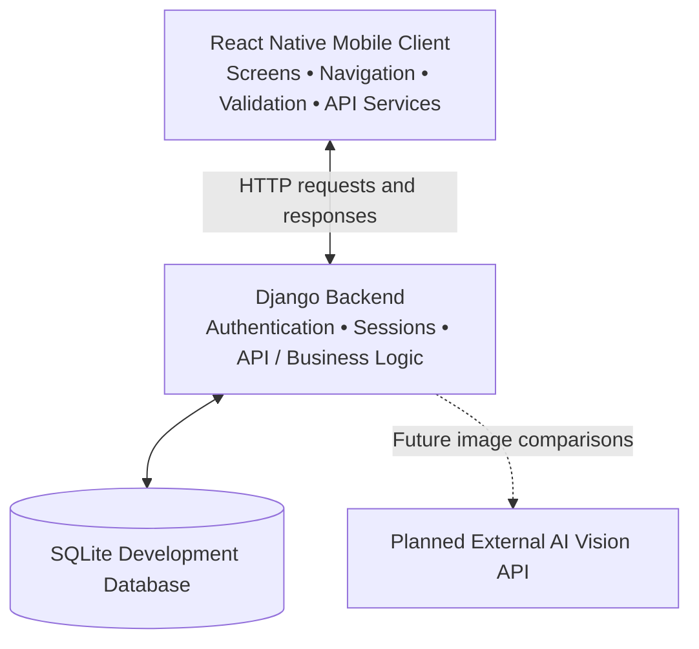
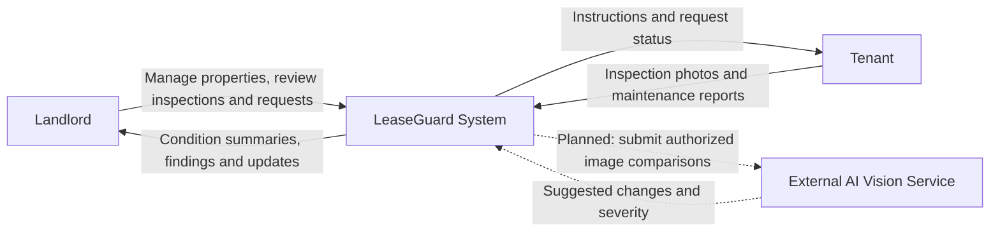

# LeaseGuard

**Smarter Property Monitoring Through AI-Powered Inspections**

[](https://github.com/jaskaranbhogal/LeaseGuard/actions/workflows/ci.yml)

LeaseGuard is a mobile property management application designed to help landlords remotely monitor rental properties while giving tenants a simple way to document property conditions, complete inspections, and report maintenance issues.

The application aims to simplify rental property inspections by combining guided photo submissions, AI-assisted image comparisons, maintenance tracking, and property condition history into one platform.

Built with React Native, TypeScript, Python, and Django, LeaseGuard is being developed as a Software Engineering Capstone Project at Farmingdale State College.

**Project Links:**

- [Figma Prototype](https://www.figma.com/design/28N5do1M7uUQwJWH3uKGSb/LeaseGuard-%E2%80%93-Sprint-Prototype)
- [GitHub Project Board](https://github.com/users/jaskaranbhogal/projects/1/views/1)
- [GitHub Repository](https://github.com/jaskaranbhogal/LeaseGuard)
- [User Stories](USER_STORIES.md)

---

## The Problem

Landlords who manage multiple rental properties, especially those located in different cities or states, often struggle to monitor property conditions between tenant move-in and move-out.

Traditional inspections may require landlords to visit properties themselves, hire inspectors, or rely entirely on tenant reports. This can lead to delayed maintenance, unnoticed damage, and disagreements over property conditions.

Tenants also face challenges documenting pre-existing damage, communicating maintenance concerns, and tracking the progress of reported issues.

LeaseGuard aims to address these problems by creating a shared digital record of rental property conditions.

---

## Our Solution

LeaseGuard provides landlords and tenants with a centralized mobile application for managing property inspections and maintenance.

Landlords will be able to manage their properties, schedule inspections, review submitted photos, and monitor changes in property conditions.

Tenants will be able to complete guided inspections, document existing damage, submit maintenance requests, and track the status of reported issues.

A planned AI-assisted inspection system will compare newly submitted property photos against move-in baseline images to help identify visible changes, classify potential damage, and prioritize findings for landlord review.

Final decisions regarding property damage will remain with the landlord rather than being automatically determined by AI.

---

## Key Features

The following features represent the planned application scope. See the Development Status section for the current implementation progress.

### 1. User Authentication

- Account registration and login.
- Secure password handling.
- Forgot password and password reset functionality.
- Session-based authentication with launch/foreground session checks and role-specific navigation.
- Separate landlord and tenant experiences planned.

### 2. Property and Unit Management

- Add and manage multiple rental properties.
- Create individual units within properties.
- Assign tenants to rental units.
- Edit property and unit information.
- View property information from a landlord dashboard.

### 3. Inspection Scheduling

- Schedule inspections for individual rental units.
- Display upcoming inspections.
- Allow tenants to provide availability for inspections.
- Track inspection completion status.

### 4. Guided Property Inspections

- Provide instructions for photographing specific property areas.
- Capture photos of walls, floors, appliances, and fixtures.
- Allow tenants to review and retake photos.
- Submit inspection photos for review.
- Maintain consistent inspection documentation.

### 5. AI-Assisted Damage Detection

- Establish baseline photos documenting move-in conditions.
- Compare new inspection photos against baseline images.
- Identify possible visible changes.
- Distinguish potential damage from normal wear.
- Assign severity levels to flagged findings.
- Allow landlords to review and confirm or dismiss AI findings.

### 6. Maintenance Requests

- Allow tenants to submit maintenance problems.
- Attach photos or videos and descriptions.
- Categorize reported maintenance issues.
- Allow landlords to review maintenance requests.
- Track maintenance progress and resolution status.

### 7. Property Condition History

- Store records of completed property inspections.
- Review historical inspection findings.
- Compare property conditions over time.
- Maintain a shared condition history for landlords and tenants.

---

## Tech Stack

| Category | Technologies |
|----------|--------------|
| Mobile Frontend | React Native, TypeScript, React |
| Navigation | React Navigation |
| Backend | Python, Django |
| API Development | Django REST Framework (planned for additional APIs) |
| Current Database | SQLite |
| Planned AI Integration | Vision-capable AI API (provider to be finalized) |
| iOS Development | Xcode, CocoaPods |
| Android Development | Android Studio, Android SDK |
| Frontend Testing | Jest, React Native Testing Library tools |
| Backend Testing | Django Test Framework |
| Code Quality | ESLint, TypeScript |
| CI | GitHub Actions |
| Version Control | Git, GitHub |
| UI/UX Design | Figma |
| Project Management | GitHub Projects |

The current backend uses SQLite for development. A production database and AI service have not yet been finalized.

---

## Architecture

LeaseGuard uses a **client-server architecture** with separation between presentation, API/business logic, and data persistence.



| Layer | Location | Responsibility |
|---|---|---|
| **Presentation / client** | `frontend/src/screens`, `components`, `navigation`, `theme` | Role-aware screens, navigation, display, form input and validation |
| **Client services** | `frontend/src/services`, `utils` | Backend configuration, API calls, authentication helpers |
| **Server / application** | `accounts/`, `backend/` | Django authentication endpoints, session and CSRF handling, password reset, server-side validation |
| **Data** | Django models and SQLite (development) | Persistent account data and server-side records |
| **Planned services** | Future Django endpoints and external AI integration | Property/unit management, inspections, maintenance, photo handling and advisory image comparison |

**Typical current request:** React Native login screen → frontend authentication service → Django authentication endpoint → account/database validation → session response → role-aware client navigation.

**Planned inspection request:** Tenant captures images → Django inspection/photo endpoints → stored evidence → optional AI comparison → findings presented to a landlord for explicit review. The planned path is not yet a completed production workflow.

Authentication is already connected to the backend; other domain features remain partial or planned. Never put private AI credentials in the mobile application.

---

## Getting Started

Follow these instructions to run LeaseGuard locally.

### Prerequisites

Install the following development tools:

- Python 3.12
- Node.js 22 or newer
- npm
- Git
- Xcode and CocoaPods for iOS development
- Android Studio and Android SDK for Android development

For detailed React Native environment requirements, see:

https://reactnative.dev/docs/set-up-your-environment

**Note:** LeaseGuard currently uses the React Native CLI, not Expo.

### 1. Clone the Repository

```bash
git clone https://github.com/jaskaranbhogal/LeaseGuard.git
cd LeaseGuard
```

### 2. Backend Setup

The Django backend is located at the repository root.

Create a Python virtual environment:

```bash
python3 -m venv venv
```

Activate the environment.

**macOS/Linux:**

```bash
source venv/bin/activate
```

**Windows:**

```powershell
venv\Scripts\Activate.ps1
```

Install dependencies:

```bash
python -m pip install -r requirements.txt
```

Create the environment configuration file:

```bash
cp .env.example .env
```

Edit `.env` to configure the development environment.

Example:

```env
DJANGO_DEBUG=true
DJANGO_ALLOWED_HOSTS=localhost,127.0.0.1,[::1]

EMAIL_BACKEND=django.core.mail.backends.console.EmailBackend
PASSWORD_RESET_BASE_URL=http://localhost:8000
```

For local development, Django can generate a persistent development-only secret key.

Production deployments must provide a secure `DJANGO_SECRET_KEY`.

**Important:** Django does not automatically load the `.env` file.

On macOS/Linux, export the configured values:

```bash
set -a
source .env
set +a
```

Apply database migrations:

```bash
python manage.py migrate
```

Start the Django development server:

```bash
python manage.py runserver 127.0.0.1:8000
```

The backend will run at:

http://localhost:8000

The Django admin interface is located at:

http://localhost:8000/admin/

#### Password Reset Worker

LeaseGuard uses a separate Django management command to process queued password reset requests.

Open another terminal from the repository root, activate the same Python environment, and export the same environment variables.

Run:

```bash
python manage.py send_password_resets
```

In the default development configuration, password reset links are printed to the worker terminal rather than delivered through email.

Real email delivery requires SMTP configuration.

For more information, see:

[Authentication Documentation](docs/AUTHENTICATION.md)

### 3. Frontend Setup

Open another terminal.

Navigate to the React Native project:

```bash
cd frontend
```

Install dependencies:

```bash
npm ci
```

Start the Metro development server:

```bash
npm start
```

Keep Metro running while developing the mobile application.

### 4. Run on iOS

iOS development requires macOS, Xcode, and CocoaPods.

From the `frontend` directory, use the version in `.ruby-version` (Ruby 2.6.10, matching Dev’s committed lockfile) and Bundler 1.17.2, then install the Ruby dependencies:

```bash
bundle install
```

Install CocoaPods dependencies:

```bash
cd ios
bundle exec pod install
cd ..
```

Run the application:

```bash
npm run ios
```

Alternatively, open the Xcode workspace:

```text
frontend/ios/frontend.xcworkspace
```

Select an available iOS simulator and run the application.

The iOS project includes the scene lifecycle configuration required for compatibility with newer Xcode/iOS SDKs.

### 5. Run on Android

Start an Android emulator using Android Studio.

From the `frontend` directory, run:

```bash
npm run android
```

Make sure Metro is running in a separate terminal.

### 6. Backend API Configuration

The mobile application's API configuration is located at:

```text
frontend/src/services/api.config.json
```

It includes:

```json
{
  "developmentBaseUrl": "",
  "productionBaseUrl": ""
}
```

When the development URL is empty, the application attempts to derive the local development backend address.

For a physical device, configure an API address reachable from that device and update Django's allowed hosts accordingly.

Before production deployment, configure a valid HTTPS backend address.

Do not store private API keys or secrets inside the mobile frontend.

---

## Authentication

LeaseGuard includes an authentication implementation using Django and React Native.

### Implemented Authentication Features

- Registration with name, email, password, and explicit tenant/landlord selection.
- Email and password login.
- Secure password hashing using Django.
- Form validation and error handling.
- Session-based authentication with launch/foreground session checks and role-specific navigation.
- CSRF-protected API requests.
- Forgot password requests.
- Password reset token generation and confirmation.
- Login, registration, and reset request rate limiting.
- Logout functionality.

### Authentication API Endpoints

| Method | Endpoint | Description |
|--------|----------|-------------|
| GET | `/api/auth/csrf/` | Obtain a CSRF token |
| POST | `/api/auth/register/` | Register a tenant or landlord account |
| GET | `/api/auth/session/` | Return the signed-in user and persisted role (401 if signed out) |
| POST | `/api/auth/login/` | Authenticate a user |
| POST | `/api/auth/logout/` | End the authenticated session |
| POST | `/api/auth/password-reset/` | Request a password reset |

Django also provides web-based password reset confirmation pages.

For request formats, configuration, and verification details, refer to:

[docs/AUTHENTICATION.md](docs/AUTHENTICATION.md)

**Current scope:** Tenants reach the tenant demo, landlords reach a coming-soon screen with logout, and legacy accounts without roles see an assignment-needed screen. Property ownership and unit membership are not granted by account type. See [tenant integration and verification](docs/TENANT_INTEGRATION.md).

---

## Test Plan

LeaseGuard uses complementary tests to check isolated logic, service interactions, and real user flows. Test cases below distinguish **existing automated coverage** from **planned coverage**.

| Test category | What it checks | Example cases | Status / tools |
|---|---|---|---|
| **Unit / component testing** | Individual screens, helpers and validation behavior in isolation | Required login inputs, registration role selection, form errors, button and navigation behavior | Jest and React Native Testing Library; authentication tests exist |
| **Backend/API integration testing** | Django endpoints, session security and database interactions | Register → authenticate → retrieve session; invalid credentials; CSRF handling; password-reset requests | Django test framework; account tests exist |
| **Cross-layer integration testing** | Mobile services talking to the Django backend | Successful login persists session and selects the proper role; session expiration produces a safe signed-out state | Manual/partial; expand automated coverage |
| **End-to-end / usability testing** | A complete task from the user's viewpoint | Landlord finds a unit, reviews inspection evidence and follows up; tenant submits a maintenance report and checks its status | Planned as corresponding domain APIs and flows become functional |

### Representative Test Cases

| ID | Category | Procedure | Expected result |
|---|---|---|---|
| UT-01 | Unit/component | Submit registration form with a missing required field | Clear validation message; no submission |
| UT-02 | Unit/component | Select landlord or tenant during sign-up | Selected role is included in the registration flow |
| IT-01 | Backend integration | Register, log in, and request session details | Authorized session returns the correct user and role |
| IT-02 | Backend integration | Attempt a protected action without an authorized session/CSRF token | Request is rejected safely |
| E2E-01 | User journey (planned) | Landlord opens a unit and reviews a completed inspection | Evidence and follow-up options are understandable |
| E2E-02 | User journey (planned) | Tenant submits a maintenance issue with a photo | Saved request can later be found with its status |

### Running Existing Automated Checks

From `frontend/`:

```bash
npm test -- --ci --runInBand
npx tsc --noEmit
npm run lint
```

From the repository root, with the Python environment configured:

```bash
python manage.py test
python manage.py check
python manage.py makemigrations --check --dry-run
```

GitHub Actions runs frontend and Django checks on pushes and pull requests targeting `main`. Native-device checks, complete domain integration, and end-to-end journeys still need separate verification; the table defines test coverage and targets, **not a claim that all cases currently pass**.

---

## Continuous Integration

LeaseGuard uses GitHub Actions to automatically run code quality checks and tests.

The workflow is defined in:

```text
.github/workflows/ci.yml
```

### Django CI

- Installs Python dependencies.
- Runs Django system checks.
- Checks database migration consistency.
- Runs Django tests.

### React Native CI

- Installs Node.js dependencies.
- Checks TypeScript compilation.
- Runs ESLint.
- Executes Jest tests.

The workflow runs automatically on:

- Pull requests targeting `main`.
- Pushes to `main`.
- Manual workflow dispatch.

This helps detect problems before code changes are merged into the main branch.

**Current scope:** CI runs backend and frontend checks. Full native iOS/Android builds and automated deployment are not currently included.

[View GitHub Actions](https://github.com/jaskaranbhogal/LeaseGuard/actions)

---

## Development Status

LeaseGuard is currently under active development.

### Implemented

- [x] Initial React Native project setup.
- [x] Django backend project setup.
- [x] SQLite development database.
- [x] React Navigation authentication flow.
- [x] Loading/splash screen.
- [x] Login screen.
- [x] Registration screen.
- [x] Forgot password screen.
- [x] Password reset confirmation screen.
- [x] Django authentication endpoints.
- [x] Session and CSRF handling.
- [x] Password reset request processing.
- [x] Shared frontend components and styling.
- [x] iOS scene lifecycle compatibility changes.
- [x] Frontend authentication tests.
- [x] Backend authentication tests.
- [x] GitHub Actions CI workflow.

### Planned / In Progress

- [ ] Landlord and tenant role management.
- [ ] Complete landlord dashboard.
- [ ] Complete tenant dashboard.
- [ ] Property and unit management APIs.
- [ ] Property creation and editing.
- [ ] Tenant assignment to units.
- [ ] Inspection scheduling.
- [ ] Guided camera inspection workflow.
- [ ] Photo uploads and baseline storage.
- [ ] AI-assisted image comparison.
- [ ] Damage severity classification.
- [ ] Landlord inspection review.
- [ ] Maintenance request submission and tracking.
- [ ] Property condition history.
- [ ] Notifications.
- [ ] Frontend integration with the remaining backend APIs.
- [ ] End-to-end testing.
- [ ] Production deployment.

Some screens and service files are scaffolded but are not yet connected to functional application workflows.

Development tasks and priorities are tracked through the project's GitHub board.

---

## Project Structure

```text
LeaseGuard/
├── .github/
│   └── workflows/
│       └── ci.yml
│
├── accounts/
│   ├── management/
│   ├── migrations/
│   ├── templates/
│   ├── models.py
│   ├── views.py
│   └── tests.py
│
├── backend/
│   ├── settings.py
│   ├── urls.py
│   ├── asgi.py
│   └── wsgi.py
│
├── docs/
│   └── AUTHENTICATION.md
│
├── frontend/
│   ├── android/
│   ├── ios/
│   ├── __tests__/
│   ├── src/
│   │   ├── assets/
│   │   ├── components/
│   │   ├── navigation/
│   │   ├── screens/
│   │   │   ├── auth/
│   │   │   ├── landlord/
│   │   │   ├── tenant/
│   │   │   └── shared/
│   │   ├── services/
│   │   ├── theme/
│   │   ├── types/
│   │   └── utils/
│   ├── App.tsx
│   ├── package.json
│   └── README.md
│
├── .env.example
├── manage.py
├── requirements.txt
├── USER_STORIES.md
└── README.md
```

---

## Project Management

LeaseGuard follows an Agile development approach.

The team uses GitHub Projects to organize user stories, monitor development progress, and coordinate work across sprints.

The project board uses the following workflow:

1. Product Backlog
2. Sprint Backlog
3. In Progress
4. Testing / Review
5. Done

Features are broken down into user stories with acceptance criteria to guide implementation and testing.

Code changes are managed through Git branches and pull requests.

GitHub Actions provides automated verification for changes targeting the main branch.

**[View the Project Board](https://github.com/users/jaskaranbhogal/projects/1/views/1)**

**[View User Stories](USER_STORIES.md)**

---

## Prototype

LeaseGuard uses a user-centered Figma prototype to explore how landlords and tenants document rental property conditions and communicate maintenance needs.

**[Open the LeaseGuard Figma Prototype](https://www.figma.com/design/28N5do1M7uUQwJWH3uKGSb/LeaseGuard-%E2%80%93-Sprint-Prototype)**

> **Prototype review:** Ensure the Figma sharing setting allows anyone with the link to view. The design file should contain the personas, system context diagram, core UI frames, and a connected user journey described below.

### Product Goal

Help landlords remotely monitor property conditions and coordinate inspections while giving tenants a clear way to document conditions, report maintenance concerns, and track follow-up. AI-assisted comparisons are a *planned* aid to landlord review, not a replacement for human judgment.

### Personas

The following are representative design personas, not accounts or interviewed real users.

| | Primary user: Maya (remote landlord) | Secondary user: Alex (tenant) |
|---|---|---|
| **Context** | Manages several rental units while living away from them | Rents a unit and needs a record of its condition |
| **Main goal** | See property condition and maintenance needs without routine travel | Report problems quickly and know what happens next |
| **Pain points** | Delayed updates, scattered photos, difficulty comparing inspection records | Unclear reporting process, repeated explanations, no status visibility |
| **Needs** | Property overview, inspection history, clear photo evidence, reviewable findings | Guided photo capture, simple maintenance form, request history and status |
| **Success looks like** | Can identify and follow up on issues from one dashboard | Can submit evidence and confirm the request is recorded |

### System Context Diagram

This is a **system context** view, not a deployment diagram. The landlord and tenant interact with LeaseGuard; the external AI image service is a proposed integration. The database is internal to the system, so it is not shown as an external actor.



### UI: Key Figma Screens

The design should show both role-specific experiences, including:

- **Shared:** sign up with landlord/tenant role selection, login, password recovery and notifications.
- **Landlord:** dashboard, property and unit details, inspection scheduling, inspection photo/AI finding review, and maintenance tracking.
- **Tenant:** dashboard, guided inspection photo submission, maintenance reporting with attachments, request history/details, and status visibility.

The Figma prototype represents the *intended user experience*. Some screens are mockups or scaffolds, and property, inspection, maintenance and AI services are still under development.

### UX: Primary User Journey (Remote Landlord)

1. **Sign in:** The landlord authenticates and reaches the landlord experience.
2. **Find a property:** Selects the correct property and rental unit from the dashboard.
3. **Check inspections:** Reviews upcoming or completed inspections and the attached evidence.
4. **Assess condition:** Compares photo records and evaluates any proposed AI-assisted findings, when available.
5. **Take action:** Reviews a maintenance concern, decides on follow-up, and tracks its status.
6. **Confirm:** Returns to the dashboard or history to see a clear record of the issue and next steps.

**UX acceptance criteria:** The landlord can identify the relevant unit, understand the inspection evidence, distinguish suggestions from confirmed issues, and find a follow-up action without losing context. This is the prototype journey to demonstrate in Figma; it is not a claim that every step is implemented today.

---

## Team Members

**Group 4 — Software Engineering Capstone**

| Team Member | Role |
|-------------|------|
| Jaskaran Bhogal | Development Team Member |
| Jonathan Peves | Development Team Member |
| Matthew Motieram | Development Team Member |
| Dev Mondal | Development Team Member |

LeaseGuard is a collaborative project developed as part of the Software Engineering coursework at Farmingdale State College.

All team members contribute to the project's planning, design, implementation, testing, and review.

---

## Future Goals

The long-term goal of LeaseGuard is to provide a reliable property monitoring platform that reduces the need for frequent physical inspections while improving communication between landlords and tenants.

Future work will focus on completing the full landlord and tenant workflows, integrating AI-assisted property assessments, improving maintenance tracking, and establishing persistent inspection records.

The system will continue to prioritize user review and transparency when presenting AI-generated findings.

---

## Acknowledgments

This project uses tools and technologies provided by:

- [React Native](https://reactnative.dev/)
- [React Navigation](https://reactnavigation.org/)
- [Django](https://www.djangoproject.com/)
- [Django REST Framework](https://www.django-rest-framework.org/)
- [GitHub Actions](https://github.com/features/actions)
- [Figma](https://www.figma.com/)

Developed by Group 4 at Farmingdale State College.
