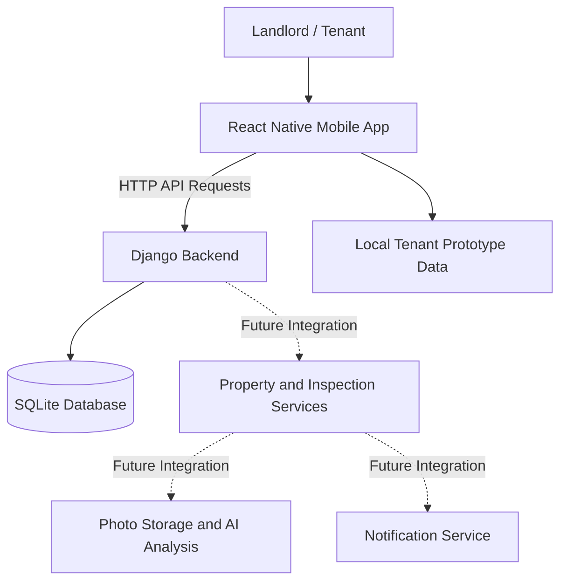

# LeaseGuard

**Smarter Property Monitoring Through AI-Powered Inspections**

[](https://github.com/jaskaranbhogal/LeaseGuard/actions/workflows/ci.yml)

LeaseGuard is a mobile property management application designed to help landlords remotely monitor rental properties while giving tenants a simple way to document property conditions, complete inspections, and report maintenance issues.

The application aims to simplify rental property inspections by combining guided photo submissions, AI-assisted image comparisons, maintenance tracking, and property condition history into one platform.

Built with React Native, TypeScript, Python, and Django, LeaseGuard is being developed as a Software Engineering Capstone Project at Farmingdale State College.

**Project Links:**

- [Figma Prototype](https://www.figma.com/design/28N5do1M7uUQwJWH3uKGSb/LeaseGuard-%E2%80%93-Sprint-Prototype)
- [GitHub Project Board](https://github.com/users/jaskaranbhogal/projects/1/views/1)
- [GitHub Repository](https://github.com/jaskaranbhogal/LeaseGuard)
- [User Stories](USER_STORIES.md)

---

## Prototype

LeaseGuard's user-centered prototype was designed in Figma to demonstrate how landlords and tenants interact with the application. The prototype follows the product goal of providing landlords with remote visibility into rental-unit conditions while giving tenants a consistent way to document inspections, maintenance issues, and property changes.

**[View the LeaseGuard Figma Prototype](https://www.figma.com/design/28N5do1M7uUQwJWH3uKGSb/LeaseGuard-%E2%80%93-Sprint-Prototype)**

### User Personas

Two personas were developed to represent the application's primary users.

**Primary Persona — Marcus Reed (Landlord)**

Marcus is a 42-year-old landlord managing six rental units across Long Island and Queens. His primary goal is to monitor property conditions remotely without having to visit every property.

His main challenges include identifying property damage early, maintaining consistent inspection documentation, and tracking unresolved maintenance requests.

LeaseGuard addresses these needs through property management, inspection scheduling, AI-assisted findings, and maintenance tracking.

**Secondary Persona — Alyssa Patel (Tenant)**

Alyssa is a 27-year-old tenant who rents a one-bedroom apartment and works full time. She wants an easy way to document property conditions, complete inspections, and report maintenance problems.

Her challenges include knowing which photographs landlords need, documenting pre-existing damage, and tracking the status of maintenance requests.

LeaseGuard provides guided inspections, maintenance reporting, availability submissions, and property condition history.

### Context Diagram

The Figma prototype includes a context diagram identifying LeaseGuard's system boundary and its external actors.

These include:

- **Landlord:** Manages properties, schedules inspections, reviews findings, and tracks maintenance.
- **Tenant:** Completes inspections, reports maintenance problems, and submits availability.
- **AI Analysis Service (Planned):** Analyzes inspection photographs and identifies potential property changes.
- **Notification Service (Planned):** Delivers inspection reminders, maintenance updates, and review alerts.

### User Interface Design

The prototype includes mobile interface designs for:

- Loading, login, registration, and password reset.
- Landlord and tenant dashboards.
- Property and unit management.
- Inspection scheduling and guided inspections.
- AI-assisted inspection findings.
- Maintenance requests and progress tracking.
- Property condition history.
- Notifications and settings.

The design uses consistent navigation, styling, and interface components to support usability across both user roles.

### User Experience Workflows

The prototype demonstrates two primary user journeys.

**Landlord Workflow:**

1. Sign in to the application.
2. Add or select a rental property.
3. Schedule an inspection.
4. Review submitted inspection photographs.
5. Assess AI-generated findings.
6. Make a final decision on identified changes.
7. Track maintenance and property condition history.

**Tenant Workflow:**

1. Open the tenant dashboard.
2. Start a scheduled inspection.
3. Follow guided photography instructions.
4. Review and submit inspection photographs.
5. Report maintenance issues.
6. Submit inspection availability.
7. Review property condition history.

These workflows demonstrate how LeaseGuard's proposed features support the product goal and provide a consistent experience for landlords and tenants.

---

## The Problem

Landlords who manage multiple rental properties, especially those located in different cities or states, often struggle to monitor property conditions between tenant move-in and move-out.

Traditional inspections may require landlords to visit properties themselves, hire inspectors, or rely entirely on tenant reports. This can lead to delayed maintenance, unnoticed damage, and disagreements over property conditions.

Tenants also face challenges documenting pre-existing damage, communicating maintenance concerns, and tracking the progress of reported issues.

LeaseGuard aims to address these problems by creating a shared digital record of rental property conditions.

---

## Our Solution

LeaseGuard provides landlords and tenants with a centralized mobile application for managing property inspections and maintenance.

Landlords will be able to manage their properties, schedule inspections, review submitted photos, and monitor changes in property conditions.

Tenants will be able to complete guided inspections, document existing damage, submit maintenance requests, and track the status of reported issues.

A planned AI-assisted inspection system will compare newly submitted property photos against move-in baseline images to help identify visible changes, classify potential damage, and prioritize findings for landlord review.

Final decisions regarding property damage will remain with the landlord rather than being automatically determined by AI.

---

## Key Features

The following features represent the planned application scope. See the Development Status section for the current implementation progress.

### 1. User Authentication

- Account registration and login.
- Secure password handling.
- Forgot password and password reset functionality.
- Session-based authentication with launch/foreground session checks and role-specific navigation.
- Separate landlord and tenant experiences.

### 2. Property and Unit Management

- Add and manage multiple rental properties.
- Create individual units within properties.
- Assign tenants to rental units.
- Edit property and unit information.
- View property information from a landlord dashboard.

### 3. Inspection Scheduling

- Schedule inspections for individual rental units.
- Display upcoming inspections.
- Allow tenants to provide availability for inspections.
- Track inspection completion status.

### 4. Guided Property Inspections

- Provide instructions for photographing specific property areas.
- Capture photos of walls, floors, appliances, and fixtures.
- Allow tenants to review and retake photos.
- Submit inspection photos for review.
- Maintain consistent inspection documentation.

### 5. AI-Assisted Damage Detection

- Establish baseline photos documenting move-in conditions.
- Compare new inspection photos against baseline images.
- Identify possible visible changes.
- Distinguish potential damage from normal wear.
- Assign severity levels to flagged findings.
- Allow landlords to review and confirm or dismiss AI findings.

### 6. Maintenance Requests

- Allow tenants to submit maintenance problems.
- Attach photos or videos and descriptions.
- Categorize reported maintenance issues.
- Allow landlords to review maintenance requests.
- Track maintenance progress and resolution status.

### 7. Property Condition History

- Store records of completed property inspections.
- Review historical inspection findings.
- Compare property conditions over time.
- Maintain a shared condition history for landlords and tenants.

---

## Tech Stack

| Category | Technologies |
|----------|--------------|
| Mobile Frontend | React Native, TypeScript, React |
| Navigation | React Navigation |
| Backend | Python, Django |
| API Development | Django REST Framework (planned for additional APIs) |
| Current Database | SQLite |
| Planned AI Integration | Vision-capable AI API (provider to be finalized) |
| iOS Development | Xcode, CocoaPods |
| Android Development | Android Studio, Android SDK |
| Frontend Testing | Jest, React Test Renderer |
| Backend Testing | Django Test Framework |
| Code Quality | ESLint, TypeScript |
| CI | GitHub Actions |
| Version Control | Git, GitHub |
| UI/UX Design | Figma |
| Project Management | GitHub Projects |

The current backend uses SQLite for development. A production database and AI service have not yet been finalized.

---

## Architecture

LeaseGuard follows a **client-server architecture** organized into presentation, application, and data layers. This architecture separates the mobile user interface from backend business logic and database operations.

The layered structure allows the frontend and backend to be developed, tested, and maintained independently while supporting future integrations such as AI-assisted inspections and notification services.

### 1. Frontend — Presentation Layer

The mobile frontend is developed using React Native and TypeScript, allowing LeaseGuard to support both iOS and Android.

The frontend is responsible for:

- Displaying user interfaces for landlords and tenants.
- Managing navigation between application screens.
- Validating user input.
- Handling authentication state and user interactions.
- Communicating with the Django backend.
- Displaying property, inspection, and maintenance information.

React Navigation is used to manage application navigation. Authentication state is maintained through a shared React context, which determines whether users access authentication screens or role-specific navigation.

The application currently includes functional authentication screens and tenant prototype workflows. The landlord dashboard remains under development.

The tenant prototype uses local sample data for inspections, maintenance records, and property history. These demonstrations will be connected to backend services as development progresses.

### 2. Backend — Application Layer

The backend is developed using Python and the Django framework.

Django is responsible for processing application requests, enforcing authentication rules, managing server-side logic, and interacting with the database.

Current backend functionality includes:

- User registration and authentication.
- Tenant and landlord account role validation.
- Secure password hashing and validation.
- Session management and CSRF protection.
- Password reset requests and confirmation.
- User account and database operations.

The frontend communicates with Django through HTTP API endpoints that exchange JSON data.

For example, when a user logs in, the mobile application sends credentials to the Django authentication endpoint. Django validates the credentials and establishes a session. The frontend then retrieves the authenticated user's role and displays the appropriate navigation experience.

Future backend functionality will include property management, inspection scheduling, maintenance requests, photo submissions, and condition history.

### 3. Database — Data Layer

LeaseGuard currently uses SQLite as its development database.

Django's Object-Relational Mapper (ORM) provides an interface for storing and retrieving data without requiring raw SQL for routine database operations.

The database currently manages:

- User account information.
- Authentication and session data.
- Tenant and landlord account roles.
- Password reset request records.

Future database models will support:

- Rental properties and units.
- Tenant-property assignments.
- Inspection schedules and records.
- Maintenance requests and their statuses.
- Property condition history.
- References to inspection photographs.

A production database solution will be evaluated as the project approaches deployment.

### 4. Planned AI Integration

LeaseGuard plans to introduce AI-assisted image analysis for property inspections.

The planned workflow will:

1. Store baseline photographs documenting property conditions at move-in.
2. Receive new photographs from tenant inspections.
3. Compare photographs of corresponding property areas.
4. Identify possible visible changes or damage.
5. Generate findings with recommended severity levels.
6. Present the findings to landlords for review.

The AI analysis will support decision-making rather than automatically determining whether tenants are responsible for property damage.

The AI provider and image storage solution have not yet been finalized. This functionality remains part of the planned architecture.

### 5. Architecture Diagram

The following diagram illustrates the current client-server structure and planned integrations.



The solid connections represent the current application architecture. Dashed connections represent features planned for future development.

---

## Getting Started

Follow these instructions to run LeaseGuard locally.

### Prerequisites

Install the following development tools:

- Python 3.12
- Node.js 22 or newer
- npm
- Git
- Xcode and CocoaPods for iOS development
- Android Studio and Android SDK for Android development

For detailed React Native environment requirements, see:

https://reactnative.dev/docs/set-up-your-environment

**Note:** LeaseGuard currently uses the React Native CLI, not Expo.

### 1. Clone the Repository

```bash
git clone https://github.com/jaskaranbhogal/LeaseGuard.git
cd LeaseGuard
```

### 2. Backend Setup

The Django backend is located at the repository root.

Create a Python virtual environment:

```bash
python3 -m venv venv
```

Activate the environment.

**macOS/Linux:**

```bash
source venv/bin/activate
```

**Windows:**

```powershell
venv\Scripts\Activate.ps1
```

Install dependencies:

```bash
python -m pip install -r requirements.txt
```

Create the environment configuration file:

```bash
cp .env.example .env
```

Edit `.env` to configure the development environment.

Example:

```env
DJANGO_DEBUG=true
DJANGO_ALLOWED_HOSTS=localhost,127.0.0.1,[::1]

EMAIL_BACKEND=django.core.mail.backends.console.EmailBackend
PASSWORD_RESET_BASE_URL=http://localhost:8000
```

For local development, Django can generate a persistent development-only secret key.

Production deployments must provide a secure `DJANGO_SECRET_KEY`.

**Important:** Django does not automatically load the `.env` file.

On macOS/Linux, export the configured values:

```bash
set -a
source .env
set +a
```

Apply database migrations:

```bash
python manage.py migrate
```

Start the Django development server:

```bash
python manage.py runserver 127.0.0.1:8000
```

The backend will run at:

http://localhost:8000

The Django admin interface is located at:

http://localhost:8000/admin/

#### Password Reset Worker

LeaseGuard uses a separate Django management command to process queued password reset requests.

Open another terminal from the repository root, activate the same Python environment, and export the same environment variables.

Run:

```bash
python manage.py send_password_resets
```

In the default development configuration, password reset links are printed to the worker terminal rather than delivered through email.

Real email delivery requires SMTP configuration.

For more information, see:

[Authentication Documentation](docs/AUTHENTICATION.md)

### 3. Frontend Setup

Open another terminal.

Navigate to the React Native project:

```bash
cd frontend
```

Install dependencies:

```bash
npm ci
```

Start the Metro development server:

```bash
npm start
```

Keep Metro running while developing the mobile application.

### 4. Run on iOS

iOS development requires macOS, Xcode, and CocoaPods.

From the `frontend` directory, use the version in `.ruby-version` (Ruby 2.6.10, matching the committed lockfile) and Bundler 1.17.2, then install the Ruby dependencies:

```bash
bundle install
```

Install CocoaPods dependencies:

```bash
cd ios
bundle exec pod install
cd ..
```

Run the application:

```bash
npm run ios
```

Alternatively, open the Xcode workspace:

```text
frontend/ios/frontend.xcworkspace
```

Select an available iOS simulator and run the application.

The iOS project includes the scene lifecycle configuration required for compatibility with newer Xcode/iOS SDKs.

### 5. Run on Android

Start an Android emulator using Android Studio.

From the `frontend` directory, run:

```bash
npm run android
```

Make sure Metro is running in a separate terminal.

### 6. Backend API Configuration

The mobile application's API configuration is located at:

```text
frontend/src/services/api.config.json
```

It includes:

```json
{
  "developmentBaseUrl": "",
  "productionBaseUrl": ""
}
```

When the development URL is empty, the application attempts to derive the local development backend address.

For a physical device, configure an API address reachable from that device and update Django's allowed hosts accordingly.

Before production deployment, configure a valid HTTPS backend address.

Do not store private API keys or secrets inside the mobile frontend.

---

## Authentication

LeaseGuard includes an authentication implementation using Django and React Native.

### Implemented Authentication Features

- Registration with name, email, password, and explicit tenant/landlord selection.
- Email and password login.
- Secure password hashing using Django.
- Form validation and error handling.
- Session-based authentication with launch/foreground session checks and role-specific navigation.
- CSRF-protected API requests.
- Forgot password requests.
- Password reset token generation and confirmation.
- Login, registration, and reset request rate limiting.
- Logout functionality.

### Authentication API Endpoints

| Method | Endpoint | Description |
|--------|----------|-------------|
| GET | `/api/auth/csrf/` | Obtain a CSRF token |
| POST | `/api/auth/register/` | Register a tenant or landlord account |
| GET | `/api/auth/session/` | Return the signed-in user and persisted role (401 if signed out) |
| POST | `/api/auth/login/` | Authenticate a user |
| POST | `/api/auth/logout/` | End the authenticated session |
| POST | `/api/auth/password-reset/` | Request a password reset |

Django also provides web-based password reset confirmation pages.

For request formats, configuration, and verification details, refer to:

[docs/AUTHENTICATION.md](docs/AUTHENTICATION.md)

**Current scope:** Tenants reach the tenant demo, landlords reach a coming-soon screen with logout, and legacy accounts without roles see an assignment-needed screen. Property ownership and unit membership are not granted by account type. See [tenant integration and verification](docs/TENANT_INTEGRATION.md).

---

## Test Plan

LeaseGuard uses unit testing, integration testing, and manual system testing to verify that application components function correctly and communicate reliably.

Testing focuses on detecting errors, preventing regressions, validating user interactions, and ensuring that new features meet their acceptance criteria.

Automated testing is integrated into the development process through GitHub Actions.

### 1. Unit Testing

Unit testing verifies individual functions, components, and backend logic independently.

**Tools:**

- Jest for React Native frontend tests.
- React Test Renderer for component testing.
- Django's built-in testing framework for backend tests.

**Test Cases:**

| Test | Expected Result |
|------|-----------------|
| Register with valid account information | Account is created successfully |
| Register with missing or invalid fields | Registration is rejected with an appropriate error |
| Submit an unsupported account role | Backend rejects the request |
| Log in with invalid credentials | Authentication fails without creating a session |
| Validate tenant inspection steps | Inspection progress behaves correctly |
| Validate maintenance form fields | Missing required fields prevent submission |
| Request a password reset | A valid request is processed securely |

Unit tests help verify individual functions and components before they are integrated into larger workflows.

### 2. Integration Testing

Integration testing verifies that different application components work correctly together.

LeaseGuard's current integration testing focuses on authentication, navigation, sessions, and database interactions.

**Tools:**

- Django's test client and testing framework.
- Jest tests using mocked frontend API responses.
- Manual React Native and Django API testing.

**Test Cases:**

| Test | Expected Result |
|------|-----------------|
| Register a landlord or tenant | The correct account role is saved in the database |
| Log in with valid credentials | Django creates an authenticated session |
| Retrieve the current user session | Backend returns the authenticated user's information |
| Navigate after authentication | User reaches the appropriate role-specific experience |
| Log out of the application | Backend session is invalidated |
| Restore an existing session | Application restores the authenticated state when the session remains valid |
| Handle an expired session | User is redirected to authentication |
| Handle a backend network error | Application displays an error and supports retrying |

These tests help ensure that the mobile frontend, backend authentication services, and database behave consistently.

Frontend tests that use mocked API responses verify application behavior, while backend tests verify actual server-side data processing.

### 3. Manual System Testing

Manual system testing evaluates user workflows and application behavior from the user's perspective.

Testing is performed using available iOS simulators and Android development environments.

**Test Scenarios:**

1. Launch the application and verify the loading screen.
2. Register a new tenant account.
3. Log in and verify tenant dashboard navigation.
4. Navigate through the guided inspection prototype.
5. Test inspection progress and review screens.
6. Open maintenance reporting and availability forms.
7. Log out and verify navigation returns to authentication.
8. Register and log in as a landlord.
9. Verify landlord-specific navigation.
10. Test password reset and account recovery functionality.

**Expected Result:**

Users should be able to navigate supported workflows without unexpected crashes, incorrect screen transitions, or misleading success messages.

Prototype-only features should clearly indicate that inspection photographs and maintenance data have not yet been submitted to the backend.

Native platform verification will continue as additional features are integrated. Android emulator and native build testing remain part of the test plan and are not claimed as fully completed.

### 4. Continuous Integration Testing

LeaseGuard uses GitHub Actions to automatically execute frontend and backend checks.

The workflow is located at:

```text
.github/workflows/ci.yml
```

**Backend Checks:**

- Django configuration validation.
- Database migration consistency.
- Automated Django tests.

**Frontend Checks:**

- TypeScript type checking.
- ESLint code quality validation.
- Jest automated tests.

These checks help identify errors before new code is merged into the main branch.

Full native iOS and Android builds are not currently included in the GitHub Actions workflow.

### 5. Running the Tests

#### Frontend Tests

From the `frontend` directory:

```bash
npm test -- --ci --runInBand
```

Run TypeScript checks:

```bash
npx tsc --noEmit
```

Run ESLint:

```bash
npm run lint
```

#### Backend Tests

From the repository root with the virtual environment activated:

```bash
python manage.py test
```

Check Django configuration:

```bash
python manage.py check
```

Check for missing database migrations:

```bash
python manage.py makemigrations --check --dry-run
```

### 6. Future Testing

As development progresses, the testing strategy will expand to include:

- Property and unit management.
- Tenant-property authorization.
- Inspection scheduling.
- Photo capture and uploads.
- Maintenance request submission and tracking.
- AI-assisted image comparison.
- Notification delivery.
- Complete end-to-end user workflows.

Security testing will also verify that landlords and tenants can only access property information they are authorized to view.

The test plan will continue to evolve as LeaseGuard's features are implemented.

---

## Continuous Integration

LeaseGuard uses GitHub Actions to automatically run code quality checks and tests.

The workflow is defined in:

```text
.github/workflows/ci.yml
```

### Django CI

- Installs Python dependencies.
- Runs Django system checks.
- Checks database migration consistency.
- Runs Django tests.

### React Native CI

- Installs Node.js dependencies.
- Checks TypeScript compilation.
- Runs ESLint.
- Executes Jest tests.

The workflow runs automatically on:

- Pull requests targeting `main`.
- Pushes to `main` and the configured integration branch.
- Manual workflow dispatch.

This helps detect problems before code changes are merged into the main branch.

**Current scope:** CI runs backend and frontend checks. Full native iOS/Android builds and automated deployment are not currently included.

[View GitHub Actions](https://github.com/jaskaranbhogal/LeaseGuard/actions)

---

## Development Status

LeaseGuard is currently under active development.

### Implemented

- [x] Initial React Native project setup.
- [x] Django backend project setup.
- [x] SQLite development database.
- [x] React Navigation authentication flow.
- [x] Loading/splash screen.
- [x] Login screen.
- [x] Registration screen with tenant/landlord selection.
- [x] Forgot password screen.
- [x] Password reset confirmation screen.
- [x] Django authentication endpoints.
- [x] Tenant and landlord account role persistence.
- [x] Role-specific frontend navigation.
- [x] Session and CSRF handling.
- [x] Password reset request processing.
- [x] Shared frontend components and styling.
- [x] Tenant dashboard prototype with sample data.
- [x] Guided inspection prototype.
- [x] Tenant maintenance and availability prototype screens.
- [x] iOS scene lifecycle compatibility changes.
- [x] Frontend authentication and navigation tests.
- [x] Backend authentication tests.
- [x] GitHub Actions CI workflow.
- [x] Figma prototype with personas, context diagram, UI designs, and UX workflows.

### Planned / In Progress

- [ ] Complete landlord dashboard.
- [ ] Complete tenant dashboard with backend data.
- [ ] Property and unit management APIs.
- [ ] Property creation and editing.
- [ ] Tenant assignment to units.
- [ ] Inspection scheduling.
- [ ] Real camera-based inspection workflow.
- [ ] Photo uploads and baseline storage.
- [ ] AI-assisted image comparison.
- [ ] Damage severity classification.
- [ ] Landlord inspection review.
- [ ] Maintenance request submission and backend tracking.
- [ ] Persistent property condition history.
- [ ] Notifications.
- [ ] Frontend integration with the remaining backend APIs.
- [ ] End-to-end testing.
- [ ] Production deployment.

Some tenant screens currently demonstrate functionality using local sample data. These screens are not yet connected to persistent inspection, maintenance, or property management services.

Development tasks and priorities are tracked through the project's GitHub board.

---

## Project Structure

```text
LeaseGuard/
├── .github/
│   └── workflows/
│       └── ci.yml
│
├── accounts/
│   ├── management/
│   ├── migrations/
│   ├── templates/
│   ├── models.py
│   ├── views.py
│   └── tests.py
│
├── backend/
│   ├── settings.py
│   ├── urls.py
│   ├── asgi.py
│   └── wsgi.py
│
├── docs/
│   ├── AUTHENTICATION.md
│   └── TENANT_INTEGRATION.md
│
├── frontend/
│   ├── android/
│   ├── ios/
│   ├── __tests__/
│   ├── src/
│   │   ├── assets/
│   │   ├── components/
│   │   ├── context/
│   │   ├── data/
│   │   ├── navigation/
│   │   ├── screens/
│   │   │   ├── auth/
│   │   │   ├── landlord/
│   │   │   ├── tenant/
│   │   │   └── shared/
│   │   ├── services/
│   │   ├── theme/
│   │   ├── types/
│   │   └── utils/
│   ├── App.tsx
│   ├── package.json
│   └── README.md
│
├── .env.example
├── manage.py
├── requirements.txt
├── USER_STORIES.md
└── README.md
```

---

## Project Management

LeaseGuard follows an Agile development approach.

The team uses GitHub Projects to organize user stories, monitor development progress, and coordinate work across sprints.

The project board uses the following workflow:

1. Product Backlog
2. Sprint Backlog
3. In Progress
4. Testing / Review
5. Done

Features are broken down into user stories with acceptance criteria to guide implementation and testing.

Code changes are managed through Git branches and pull requests.

GitHub Actions provides automated verification for changes targeting the main branch.

**[View the Project Board](https://github.com/users/jaskaranbhogal/projects/1/views/1)**

**[View User Stories](USER_STORIES.md)**

---

## Team Members

**Group 4 — Software Engineering Capstone**

| Team Member | Role |
|-------------|------|
| Jaskaran Bhogal | Development Team Member |
| Jonathan Peves | Development Team Member |
| Matthew Motieram | Development Team Member |
| Dev Mondal | Development Team Member |

LeaseGuard is a collaborative project developed as part of the Software Engineering coursework at Farmingdale State College.

All team members contribute to the project's planning, design, implementation, testing, and review.

---

## Future Goals

The long-term goal of LeaseGuard is to provide a reliable property monitoring platform that reduces the need for frequent physical inspections while improving communication between landlords and tenants.

Future work will focus on completing the full landlord and tenant workflows, integrating AI-assisted property assessments, improving maintenance tracking, and establishing persistent inspection records.

The system will continue to prioritize user review and transparency when presenting AI-generated findings.

---

## Acknowledgments

This project uses tools and technologies provided by:

- [React Native](https://reactnative.dev/)
- [React Navigation](https://reactnavigation.org/)
- [Django](https://www.djangoproject.com/)
- [Django REST Framework](https://www.django-rest-framework.org/)
- [GitHub Actions](https://github.com/features/actions)
- [Figma](https://www.figma.com/)

Developed by Group 4 at Farmingdale State College.
